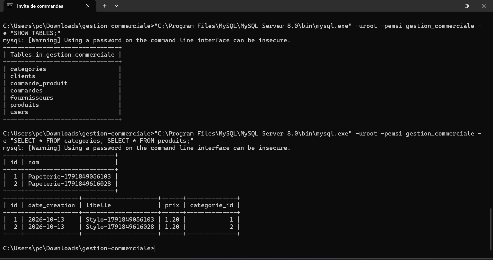
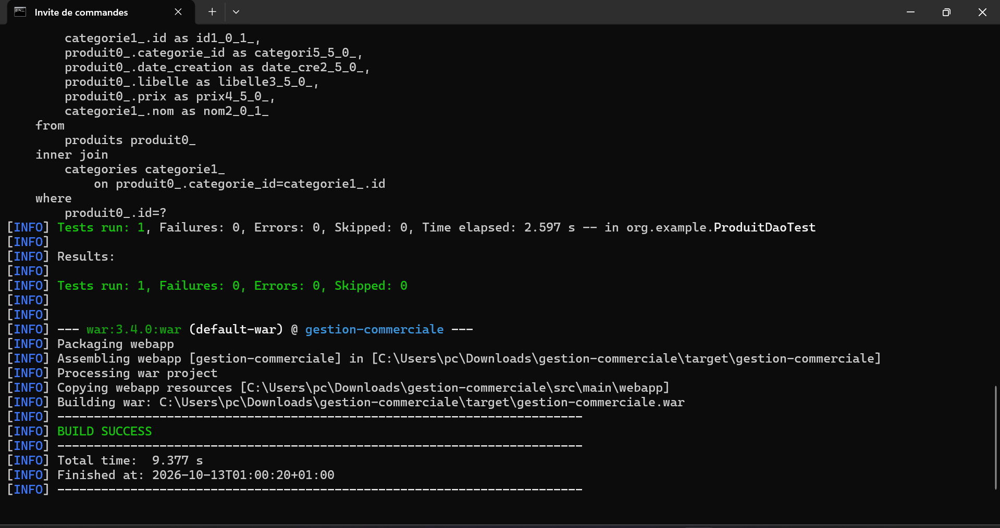
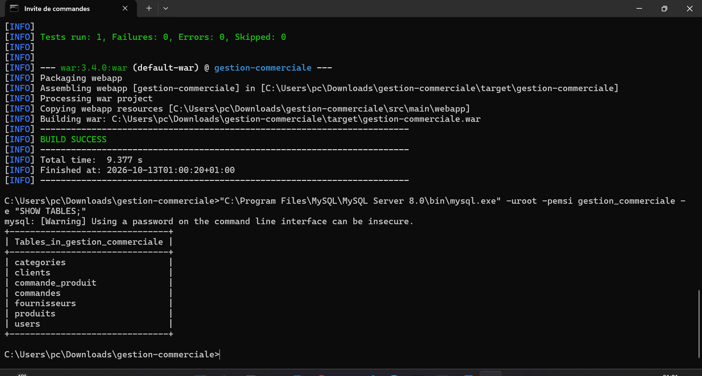

# gestion-commerciale

Ce projet correspond au TP Hibernate/JPA de gestion commerciale.

Le fichier README contient uniquement les captures d'ecran d'execution demandees, avec un commentaire avant chaque capture.

## 1. Creation et verification de la base de donnees

La capture suivante montre la creation de la base `gestion_commerciale` dans MySQL et la verification que la base existe bien.

## 2. Compilation, tests JUnit et generation du WAR

La capture suivante montre l'execution Maven du projet. Le resultat confirme que le test JUnit s'execute correctement et que le build se termine avec succes.

## 3. Verification des tables creees par Hibernate

La capture suivante montre les tables creees automatiquement par Hibernate dans la base `gestion_commerciale`, ainsi que les donnees inserees pendant le test.

